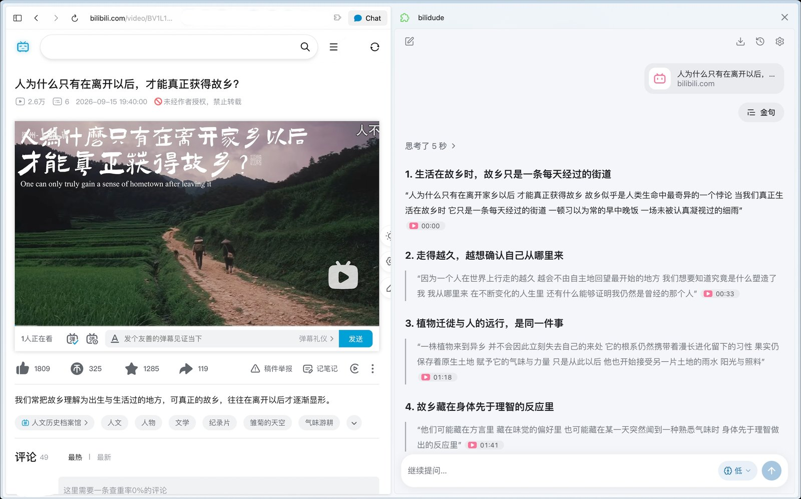

  

<h3 align="center">A little TV helper in your side panel</h3>

  Recaps, tables of contents and top quotes, with timestamps to back them up

  
  
  
  
  

  
  
  
  
  
  

  <a href="README.md">简体中文</a> | <b>English</b>

BiliDude is a Chrome extension. It reads the subtitles of the video you are watching, hands them to the model you choose, and answers questions about the video. Ask for a recap, a table of contents or the top quotes in one click, or just ask. Click a timestamp in the answer and the video jumps there.

Videos without subtitles can be transcribed from their audio first.

## Installation

BiliDude is not on the Chrome Web Store yet. For now, install it by hand:

1. Download the latest `bilidude-*-chrome.zip` from [Releases](../../releases) and unzip it.
2. Open `chrome://extensions` and turn on "Developer mode" in the top right.
3. Click "Load unpacked" and select the unzipped folder.

It needs Chrome or another Chromium browser with side panel support. Firefox and Safari are not supported.

## Usage

Click the toolbar icon to open the side panel. The first time, pick a model provider and paste your API key. DeepSeek, OpenAI, Anthropic, Google Gemini and OpenRouter are built in, and any OpenAI-compatible endpoint works too, such as a local LM Studio, Strata or Ollama.

Every provider's base URL can be changed, to reach a proxy or gateway that speaks the same protocol: DeepSeek and OpenRouter use OpenAI Chat Completions, Anthropic the Messages API, Gemini the Gemini API. With a custom base URL, OpenAI can use either Responses or Chat Completions. For a model that isn't listed, choose "Other…" and type its model ID.

Bilibili only serves its AI subtitles to logged-in users, so log in to bilibili.com in the same browser.

Turn on audio transcription in Settings. Besides Bilibili's Bcut, you can use OpenAI, Groq, Alibaba Cloud Model Studio, SiliconFlow or an OpenAI-compatible service.

The interface comes in Simplified Chinese, Traditional Chinese and English, and the answer language can be set separately.

## Privacy

BiliDude has no server and collects no data. API keys are stored only in your browser.

When you ask a question, the video's title, description, chapters, subtitles and the conversation so far go to the model provider you chose. When a video is transcribed, its audio goes to the transcription service you chose. Conversations and subtitles are stored in your browser.

## FAQ

It says the video is too long for the model

The whole transcript is sent to the model at once. Switch to a model with a longer context window; many models now take 1M tokens.

Bcut says this network is rate-limited

Bilibili limits how often one network can call Bcut. Try again later, or switch to another transcription service in Settings.

Which pages are supported

Regular videos on bilibili.com (`/video/BV…` and `/video/av…`, including multi-part videos) and `/list/…` playlists. Bangumi, courses, live streams and bilibili.tv are not supported yet.

## Development

See [CONTRIBUTING.md](CONTRIBUTING.md) (in Chinese).

## Acknowledgments

- [BiliScript](https://github.com/Edmund724/BiliScript): reference for the audio pipeline and AAC extraction.
- [bcut-asr](https://github.com/SocialSisterYi/bcut-asr): reference for Bcut speech recognition.
- [Bilitato](https://github.com/erikzhuang55/Bilitato): reference for subtitle and transcription handling.
- [pi-ai](https://www.npmjs.com/package/@earendil-works/pi-ai) and [WXT](https://wxt.dev): LLM and framework.

## Disclaimer

This project is not affiliated with Bilibili.

## Star History

<a href="https://star-history.com/#Hariketsu/bilidude&Date">
  <picture>
    <source media="(prefers-color-scheme: dark)" srcset="https://api.star-history.com/svg?repos=Hariketsu/bilidude&type=Date&theme=dark">
    
  </picture>
</a>

## License

[GPL-3.0](LICENSE). Code adapted from MIT-licensed projects is listed in [THIRD_PARTY_NOTICES.md](THIRD_PARTY_NOTICES.md).
