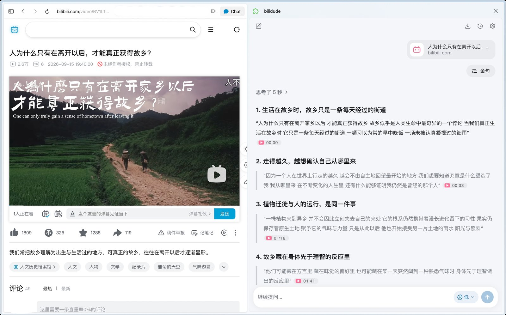

  

<h3 align="center">侧边栏里的小电视助手</h3>

  总结、目录、金句，让时间戳来帮你

  
  
  
  
  

  
  
  
  
  
  

  <b>简体中文</b> | <a href="README.en.md">English</a>

BiliDude 是一个 Chrome 扩展。它读取当前视频的字幕，交给你选的大模型来总结或提问。可以一键生成总结、目录和金句，也可以直接追问；回答里的时间戳点一下，视频就会跳过去。

现已支持直接登录 DeepSeek 账号，免填 Key 即可使用对话、语音转写和联网搜索；也可以接入其他模型服务商或本地模型。

## 安装

还没有上架 Chrome 应用商店，目前需要手动安装：

1. 在 [Releases](../../releases) 下载最新的 `bilidude-*-chrome.zip` 并解压。
2. 打开 `chrome://extensions`，打开右上角的“开发者模式”。
3. 点“加载已解压的扩展程序”，选择解压后的文件夹。

需要 Chrome 或其他支持侧边栏的 Chromium 浏览器。Firefox 和 Safari 不支持。

## 使用

点工具栏上的图标打开侧边栏。第一次使用时选择模型服务商：DeepSeek 支持直接登录账号使用（实验性），也可以切换到 API Key；另外内置了 OpenAI、Anthropic、Google Gemini 和 OpenRouter，也支持任何 OpenAI 兼容接口，比如本地的 LM Studio、Strata 或 Ollama。

每个服务商都可以改 Base URL，接同一协议的代理或网关：

- DeepSeek 和 OpenRouter 用 OpenAI Chat Completions。
- Anthropic 用 Messages API，Gemini 用 Gemini API。
- OpenAI 改了 Base URL 后可以在 Responses 和 Chat Completions 之间选。
- 列表里没有的模型，选“其他…”手动填写模型 ID。

B 站只给登录用户提供 AI 字幕，所以请在同一个浏览器里登录 bilibili.com。

模型选 DeepSeek 时，没有字幕的视频默认用 DeepSeek 转写音频，共用同一个账号或 API Key。其他情况下音频转写在设置里打开，可以用必剪、DeepSeek、OpenAI、Groq、阿里云百炼、硅基流动或 OpenAI 兼容服务。

点输入框旁的地球图标可以开启联网搜索。模型选 DeepSeek 时直接走其服务端搜索；使用其他模型时，可以在设置里单独填写 DeepSeek Key 或登录 DeepSeek 账号来启用搜索。

界面有简体中文、繁体中文和英文，回答的语言可以单独设置。

## 隐私

BiliDude 没有服务器，不收集任何数据。API Key 和 DeepSeek 账号凭证只保存在浏览器本地，仅用于直接请求对应的服务商接口。

提问时，视频的标题、简介、章节、字幕和之前的对话会发给你选的模型服务商；开启联网搜索时，模型生成的搜索词会发往 DeepSeek 搜索服务；转写时，音频会发给你选的转写服务。对话记录和字幕保存在浏览器本地。

## 常见问题

提示视频太长，当前模型放不下

整份字幕要一次性发给模型，换一个上下文更长的模型即可。现在很多模型支持 1M token。

必剪提示当前网络被限流

B 站限制了同一网络调用必剪的频率。过一段时间再试，或者在设置里换一个转写服务。

支持哪些页面

bilibili.com 的普通视频（`/video/BV…`、`/video/av…`，包括分 P）和 `/list/…` 播放列表。番剧、课程、直播和 bilibili.tv 暂不支持。

## 开发

见 [CONTRIBUTING.md](CONTRIBUTING.md)。提示词的评测方法与演进记录见 [docs/PROMPT-EVAL.md](docs/PROMPT-EVAL.md)。

## 致谢

- [BiliScript](https://github.com/Edmund724/BiliScript)：音频处理流程与 AAC 提取参考。
- [bcut-asr](https://github.com/SocialSisterYi/bcut-asr)：必剪语音识别参考。
- [Bilitato](https://github.com/erikzhuang55/Bilitato)：字幕和转写处理参考。
- [pi-ai](https://www.npmjs.com/package/@earendil-works/pi-ai) 和 [WXT](https://wxt.dev)：LLM 与框架。

## 声明

本项目与哔哩哔哩无关。

## Star History

<a href="https://star-history.com/#Hariketsu/bilidude&Date">
  <picture>
    <source media="(prefers-color-scheme: dark)" srcset="https://api.star-history.com/svg?repos=Hariketsu/bilidude&type=Date&theme=dark">
    
  </picture>
</a>

## 许可证

[GPL-3.0](LICENSE)。改编自 MIT 项目的代码见 [THIRD_PARTY_NOTICES.md](THIRD_PARTY_NOTICES.md)。
